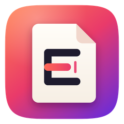
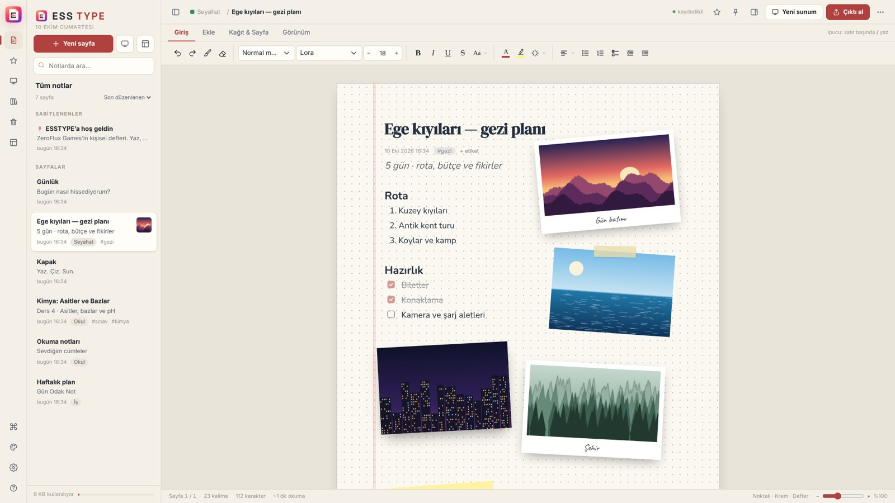
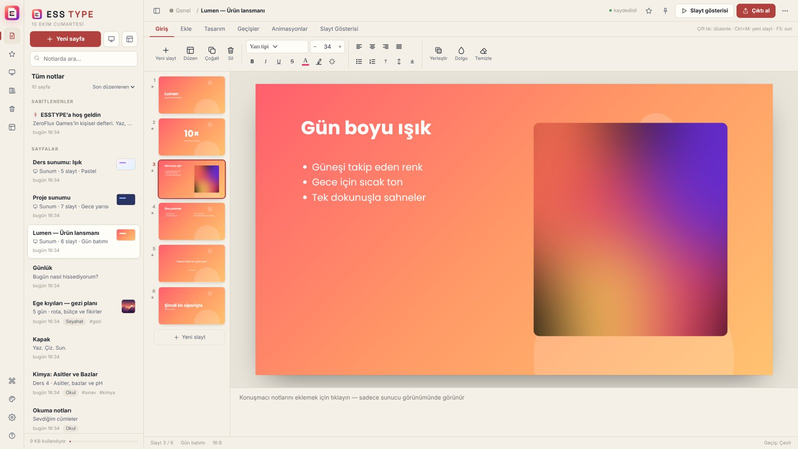
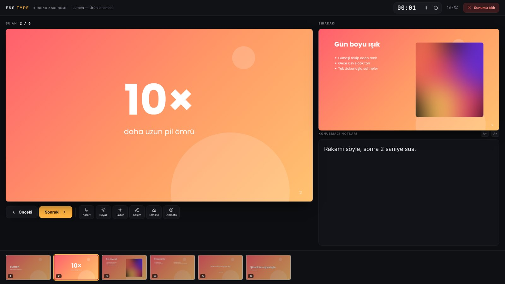
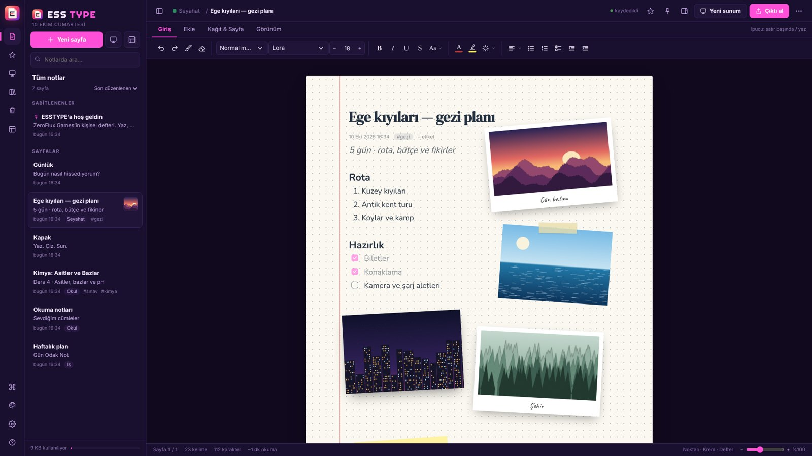
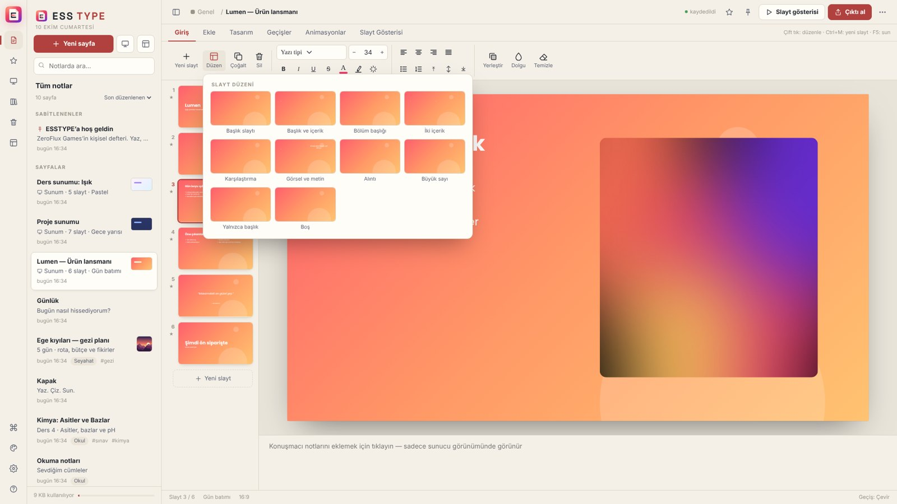
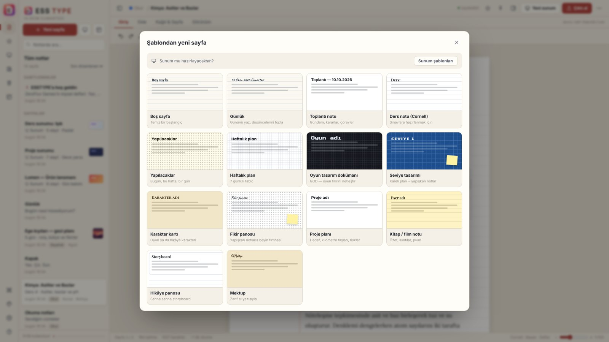

<p align="center">
  
</p>

<h1 align="center">ESSTYPE</h1>

<p align="center">
  <b>Yaz. Çiz. Sun.</b><br>
  Çevrimdışı çalışan kişisel defter ve sunum uygulaması. Tek bir HTML dosyası, kurulum yok, hesap yok.
</p>

<p align="center">
  <a href="../../releases/latest"></a>
  
  
</p>

<p align="center"></p>

> 🇬🇧 English summary is [below](#english).

---

## Neler var?

### ✍️ Defter — Word kadar güçlü, defter kadar sade
- **Gerçek sayfalar:** satırlar çizgiye kilitli kalır, sayfa dolunca yazı bir sonraki kağıda geçer. Ekranda gördüğün sayfa, yazdırılan sayfayla aynıdır.
- **13 kağıt türü** (boş, çizgili, kareli, noktalı, milimetrik, nota, Cornell…), **14 kağıt rengi**, **7 sayfa boyutu** (A5, A4, Letter, yatay, kesintisiz…).
- **38 gömülü yazı tipi**, internet gerekmez, Türkçe karakterlerin hepsi var. Yazı efektleri, vurgu, renkler.
- Tablolar, bilgi kutuları, yapılacaklar, alıntılar, kod blokları, `/` hızlı ekleme menüsü ve Markdown kısayolları.
- **Serbest nesneler:** görsel, polaroid, yapışkan not, metin kutusu, şekil ve elle çizim. Hepsi sürüklenir, boyutlandırılır, döndürülür.

### 📊 Sunum — PowerPoint gibi ayrı bir düzenleyici
Notlar slayta dönüşmez; sunumlar kendi düzenleyicisinde hazırlanır.

- Şerit menü: **Giriş · Ekle · Tasarım · Geçişler · Animasyonlar · Slayt Gösterisi**
- **10 slayt düzeni**, **13 tema**, **13 geçiş**, öğe animasyonları (tıklayınca / birlikte / sonra) ve animasyon bölmesi.
- Küçük resimleri sürükleyip sıralama, hizalama kılavuzları, geri al / yinele, konuşmacı notları.
- **Sunucu görünümü:** slaytlar projeksiyonda; notlar, süre ve sıradaki slayt senin ekranında. Lazer ve kalem iki ekranda da görünür.
- Hazır şablonlar ve bir notun başlıklarından otomatik taslak.

<p align="center">
  
  
</p>

### 📤 Dışa aktarma
PDF · Word (.docx) · PowerPoint (.pptx, metinler düzenlenebilir) · PNG/JPG · Markdown · HTML · TXT · `.esst`

### 🎨 Arayüz ve düzen
- **14 arayüz modu** (Kağıt, Gece mavisi, Neon, Sepya, Retro piksel, Orman, Lavanta, Yüksek kontrast…), vurgu rengi, odak ve daktilo modları.
- Defterler, etiketler, favoriler, çöp kutusu, **sürüm geçmişi**, bul / değiştir, **komut paleti** (`Ctrl+K`).

<p align="center">
  
  
  
</p>

---

## Kurulum

### Windows (önerilen)
1. [Releases](../../releases/latest) sayfasından `ESSTYPE-windows.zip` dosyasını indir ve aç.
2. `ESSTYPE-Kurulum.cmd` dosyasına çift tıkla.
   - Uygulama `Belgeler\ESSTYPE` klasörüne kopyalanır.
   - Masaüstüne ve Başlat menüsüne **ESSTYPE** kısayolu eklenir (Microsoft Edge uygulama penceresinde açılır).

### Her platform
`esstype.html` dosyasını Chrome, Edge veya başka bir Chromium tabanlı tarayıcıda aç. Bu kadar.

> Firefox ve Safari'de de çalışır; "sunum ekranına gönder" (Window Management API) yalnızca Chromium tabanlı tarayıcılarda vardır. Diğerlerinde "Ayrı pencerede" seçeneğini kullan.

## Gizlilik
- Hiçbir veri internete gönderilmez. Analitik yok, hesap yok, sunucu yok.
- Notlar tarayıcının **IndexedDB** deposunda, yani yalnızca senin bilgisayarında durur.
- Yedek almak için: *Ayarlar → Tüm notları yedekle* (tek `.json` dosyası) ya da sayfaları `.esst` olarak dışa aktar.

## Klavye kısayolları

| Kısayol | İşlev |
|---|---|
| `Ctrl+K` | Komut paleti |
| `Ctrl+Alt+N` | Yeni sayfa |
| `Ctrl+E` | Çıktı al (PDF, Word, PowerPoint…) |
| `Ctrl+P` | Yazdır / PDF |
| `Ctrl+H` | Bul ve değiştir |
| `Ctrl+Shift+L` | Gece / gündüz |
| `F5` / `Shift+F5` | Sunumu baştan / bu slayttan başlat |
| `/` | Hızlı ekleme menüsü |
| `F1` | Tüm kısayollar |

Sunum sırasında: `→` `Boşluk` ileri, `←` geri, `B` siyah ekran, `O` genel bakış, `L` lazer, `P` kalem, `Esc` çıkış.

## Kaynaktan derleme

Gereken: Node.js 18 veya üstü.

```bash
npm install
npm run build     # dist/esstype.html (tek dosya, tüm yazı tipleri ve kütüphaneler gömülü)
npm start         # http://localhost:5173 adresinde önizleme
```

### Proje yapısı
```
src/
  core.js      yardımcılar, temalar, yazı tipleri, kağıtlar, veritabanı
  layout.js    sayfalama motoru (çizgiye kilitli satırlar, gerçek sayfalar)
  editor.js    defter düzenleyici
  objects.js   serbest nesneler ve çizim
  present.js   slayt temaları, geçişler
  show.js      slayt gösterisi, sunucu görünümü, ikinci ekran
  deck.js      PowerPoint benzeri slayt düzenleyici
  export.js    PDF / DOCX / PPTX / PNG / MD / HTML / TXT çıktıları
  app.js       şablonlar, komut paleti, ayarlar, açılış
  body.html, style.css
scripts/build.mjs   her şeyi tek HTML dosyasında birleştirir
windows/            Windows kurulum betiği
```

Web sürümü `docs/index.html` dosyasından GitHub Pages ile yayınlanır; yeni sürümde `npm run build` sonrası `dist/index.html` dosyasını `docs/` klasörüne kopyalaman yeterli.

## Katkı
Hata bildirimleri ve öneriler için [Issues](../../issues). Ayrıntılar: [CONTRIBUTING.md](CONTRIBUTING.md).

## Lisans
[MIT](LICENSE) © 2026 ZeroFlux Games. Kullanılan kütüphaneler ve yazı tipleri: [THIRD_PARTY_NOTICES.md](THIRD_PARTY_NOTICES.md) (docx, PptxGenJS, html-to-image ve SIL OFL lisanslı Google yazı tipleri).

---

## English

**ESSTYPE** is an offline notebook and presentation app shipped as a single HTML file: no install, no account, no server.

- **Notebook:** real pages with text locked to the ruled lines, 13 paper types, 14 paper tones, 7 page sizes, 38 embedded fonts, tables, callouts, to-dos, a slash menu, and free-floating images, sticky notes, shapes and drawings.
- **Presentations:** a separate, PowerPoint-style slide editor with a ribbon, 10 layouts, 13 themes, 13 transitions, per-element animations and speaker notes.
- **Presenter view:** slides go to the projector while notes, a timer and the next slide stay on your screen. Laser and pen show on both screens.
- **Export:** PDF, DOCX, PPTX (editable text), PNG/JPG, Markdown, HTML, TXT.
- **Privacy:** everything is stored locally in IndexedDB. Nothing leaves your computer.

**Run it:** download the latest release and open `esstype.html` in any Chromium-based browser. On Windows, run `ESSTYPE-Kurulum.cmd` to get desktop and Start-menu shortcuts.
**Build it:** `npm install && npm run build` produces `dist/esstype.html`.

The UI is in Turkish. MIT licensed © 2026 ZeroFlux Games.
